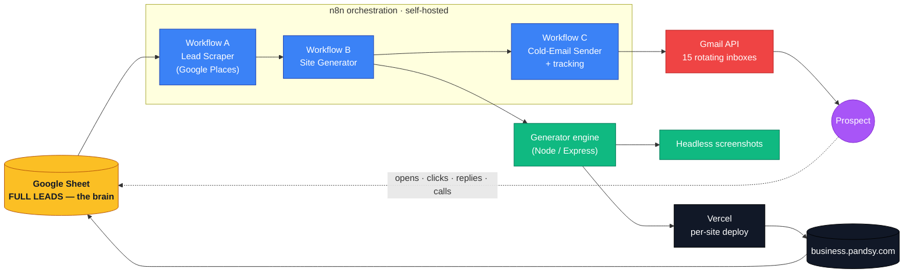
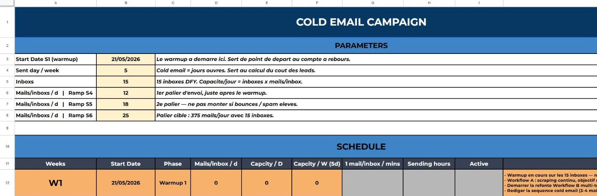
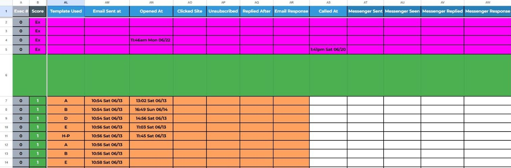
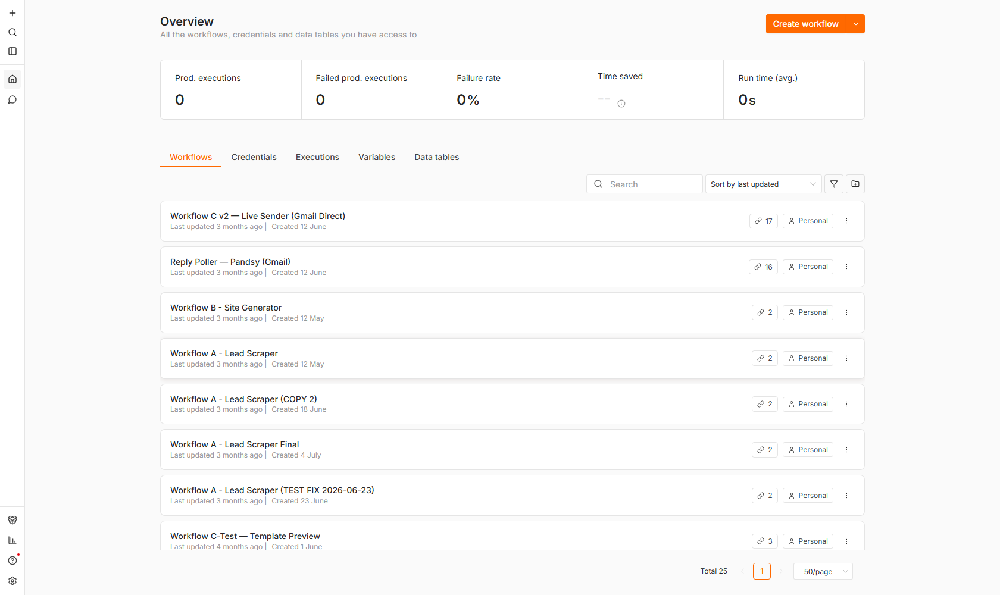

# Pandsy — Automated Website Generation & Cold-Email Outreach at Scale

> A full pipeline that scraped local-business leads across the US, generated and deployed a polished, individually-branded website for each one in ~90 seconds, then ran the cold-email campaign and tracking around it — all orchestrated from a single Google Sheet.

Private-origin project (2026), published as an archive. Not a product, not open source. Infrastructure endpoints and credentials have been stripped.

<p align="center">
  
</p>

---

## What it was

Most local businesses — auto-repair garages, plumbers, electricians — have no website or a bad one. Pandsy turned a scraped list of them into **production-deployed, individually-branded websites at scale**, then used each live site as the hook for a cold-email campaign: *"here's a free website I built for your shop — want it?"*

Everything ran off one **Google Sheet** acting as the lead database and the control panel. Each row was a business; its columns drove scraping, generation, deployment, emailing, and tracking.

**By the numbers**
- **~90 seconds** per site — scrape data in, live URL out
- **~$0 generation cost** — template-based, **no LLM tokens** at render time
- **9 designs** — 3 verticals × 3 template variants, picked by business type
- **~1,750** qualified US leads in the database after cleaning
- **270 emails/day** at full ramp, rotated across 15 warmed inboxes

---

## How it works



1. **Scrape — Workflow A.** Pulls US local businesses from the Google Places API (name, address, phone, hours, Google reviews, category) into the Sheet, and builds the correct *"leave a review"* link for each (`writereview?placeid=…`). Leads are scored and anything that already has a real website is filtered out (a Playwright site-check tests each prospect's domain).
2. **Generate — Workflow B.** Picks the next approved lead, calls the generator engine: it selects a template by business type, injects the real business data, builds the Next.js site, deploys it to Vercel under a `*.pandsy.com` subdomain, disables deployment protection, and captures hero + full-page screenshots. The live URL + captures are written back to the Sheet.
3. **Outreach — Workflow C.** A sender running every 2 minutes: reads the Sheet, filters `approved` leads inside the send window, assigns an inbox + template (rotation across 15 Gmail inboxes, per-inbox daily cap, 18–22 min gap), builds a personalized email with branded tracked links, sends via the Gmail API, and logs everything back to the Sheet (`LEADS` + `SEND-LOG`).
4. **Track.** Opens, clicks, replies, unsubscribes and inbound calls all flow back into the Sheet, with Telegram pings for anything needing a human.

---

## The Google Sheet — the brain

The entire operation was driven by one spreadsheet. No dashboards, no DB UI — just tabs and columns that every workflow reads and writes.

- **FULL LEADS** — the master list: business data, score, status (`scraping_done → approved → emailed → …`), the generated Site URL, and the tracking columns (**Opened / Clicked / Replied / Unsubscribed**) that tick as the campaign runs.
- **PLANNING** — the week-by-week cold-email roadmap (warmup → ramp → regime).
- **EMAIL-TEMPLATES**, **SEND-LOG**, **INBOX-STATUS** — template pool, per-send log, and per-inbox daily caps.
- **SCORE banners** — the list is segmented by lead quality (SCORE 1–4).

The cold-email campaign was ramped week by week — warmup → ramp → 375 mails/day across 15 inboxes:



Per-lead tracking, live in the Sheet — template rotation, send time, **open time**, clicks, replies, calls (lead PII redacted):



---

## The n8n pipeline

Three workflows do the work (shown here from a local re-import of the real exports; credentials stripped).

**Workflow A — Lead Scraper**


**Workflow B — Site Generator**


**Workflow C — Cold-Email Sender**


<details><summary>All workflows (overview)</summary>


</details>

---

## The 9 templates

Hand-built Next.js (App Router) + Tailwind templates, polished to WCAG AA — 3 variants per vertical. Every business-specific value is a `{{PLACEHOLDER}}` the generator fills; shown here with showcase demo data.

### Auto Repair
| Template 1 | Template 2 | Template 3 |
|---|---|---|
|  |  |  |

### Electricians
| Template 1 | Template 2 | Template 3 |
|---|---|---|
|  |  |  |

### Plumbers
| Template 1 | Template 2 | Template 3 |
|---|---|---|
|  |  |  |

**Live demos** (showcase data):
- Auto Repair — [t-1](https://auto-repair-t-1.vercel.app) · [t-2](https://auto-repair-t-2.vercel.app) · [t-3](https://auto-repair-t-3.vercel.app)
- Electricians — [t-1](https://electricians-t-1.vercel.app) · [t-2](https://electricians-t-2.vercel.app) · [t-3](https://electricians-t-3.vercel.app)
- Plumbers — [t-1](https://plumbers-t-1.vercel.app) · [t-2](https://plumbers-t-2.vercel.app) · [t-3](https://plumbers-t-3.vercel.app)

---

## The generator engine (`generator/`)

A small Node/Express service that turns one business's data into a deployed site.

- **Template-based, zero LLM at render time** — deterministic, fast, free. Data flows into `{{PLACEHOLDER}}` tokens.
- **Category normalization** — tolerant of messy source data (`AUTO REPAIR`, `Auto Repair`, `auto-repair` → `AUTO_REPAIR`).
- **Real assets or graceful fallback** — pulls the business's logo/photos, falls back to template samples or a clean text logo when missing.
- **Deploy + harden** — deploys to Vercel, then disables Vercel Authentication via the REST API so prospects (and screenshot bots) see the site, not a login wall.
- **Screenshots** — headless Chromium captures hero + full-page, handling cookie banners, sticky headers and lazy-loaded images.

| File | Role |
|---|---|
| `server.js` | Express API, serial job queue, screenshot serving |
| `generate-site-v2.js` | core: template pick → data injection → build → Vercel deploy → SSO disable |
| `pipeline.js` | orchestration helpers |
| `placeholder-substitute.js` | `{{PLACEHOLDER}}` substitution |
| `category-detector.js` | business-type normalization |
| `screenshot.js` | headless hero + full-page capture |
| `post-sale.js` | post-conversion handoff |

---

## Tech stack

- **Generation**: Node.js, Express, Playwright (Chromium)
- **Sites**: Next.js (App Router), React, TypeScript, Tailwind CSS
- **Orchestration**: n8n (self-hosted on a Hetzner VPS)
- **Data**: Google Sheets API (lead database), Google Places API (scraping)
- **Hosting**: Vercel (per-site deployments, `*.pandsy.com`)
- **Email**: Gmail API across 15 inboxes + Resend, with open/click/reply tracking
- **Telephony**: tracked phone number, call forwarding + logging
- **Alerts**: Telegram

---

## Repository structure

```
.
├── generator/     Node/Express site-generation engine
├── templates/     9 Next.js templates (3 verticals × 3 variants) + showcase deploy scripts
├── docs/          screenshots (templates · workflows · sheet)
├── .env.example   required environment variables
└── README.md
```

## Running it (reference)

Archive — not wired to live infrastructure. See [`.env.example`](.env.example).

```bash
cd generator && npm install && cp ../.env.example .env   # fill in your own values
node server.js
```

Deploy the 9 showcase templates to Vercel with demo data:

```bash
cd templates && VERCEL_SCOPE=your-team node scripts/deploy-showcase.mjs
```

---

## Notes

- **Private-origin & archived.** Kept for the record, not maintained.
- **Sanitized.** All real endpoints, IPs, IDs, phone numbers and credentials were removed. The raw n8n workflow exports are intentionally not included — the pipeline is documented instead.
