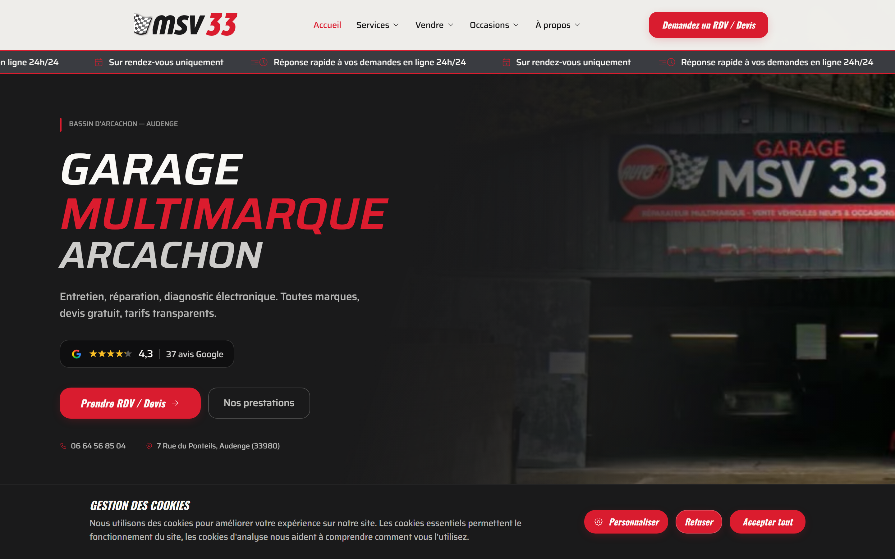
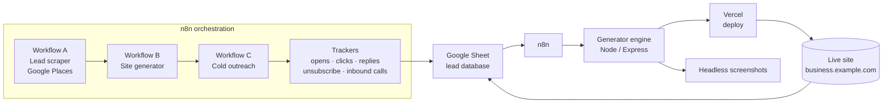
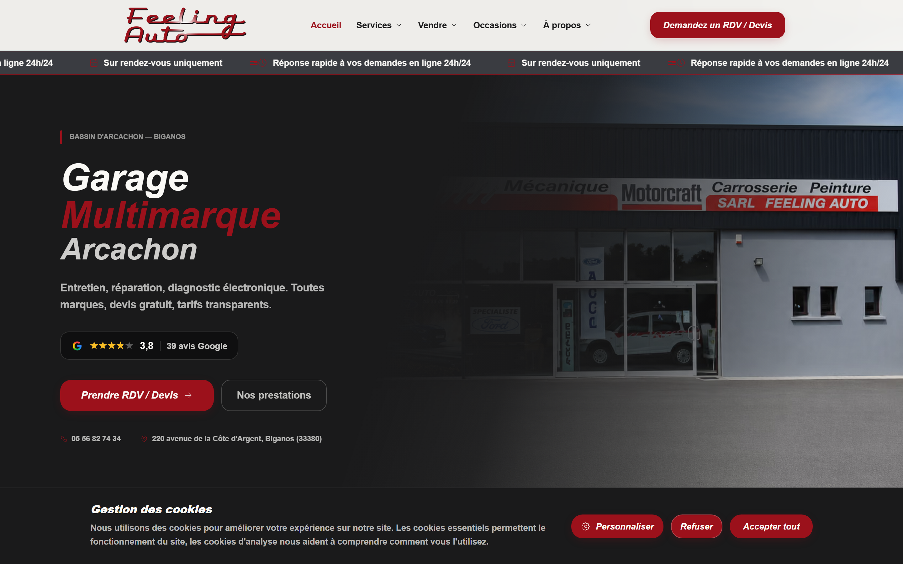
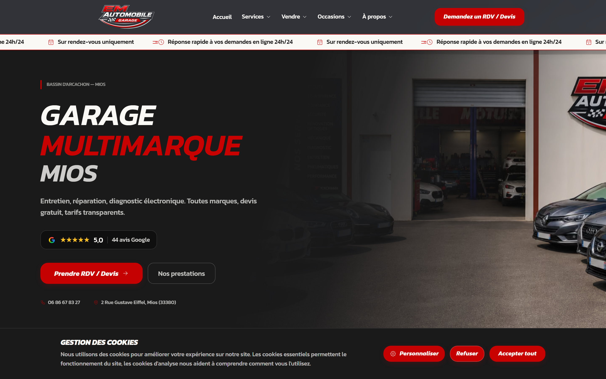
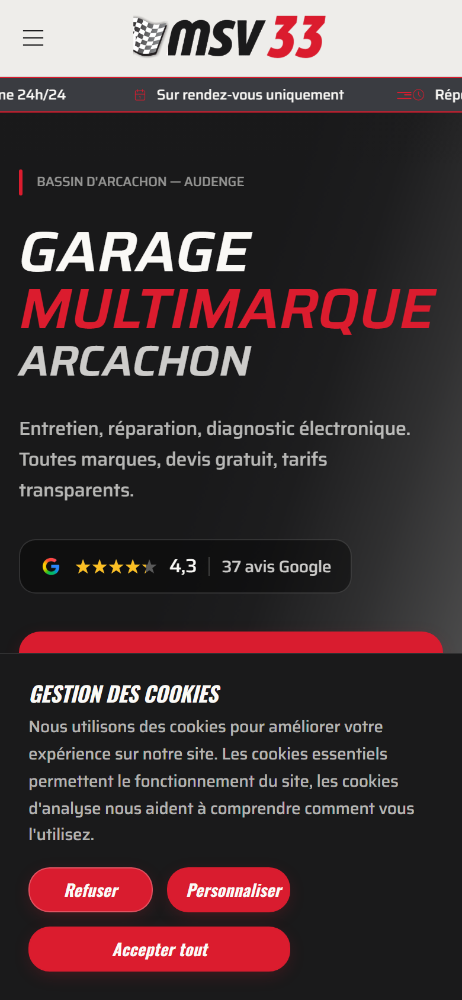

# Pandsy — Automated Website Generation & Outreach for Local Businesses

> An end-to-end pipeline that scraped local-business leads, generated a polished, deployed website for each one in ~90 seconds, and ran the cold-outreach + tracking around it — all driven from a single spreadsheet.

Private archive of a personal project (2026). Not a product, not open source. Infrastructure endpoints and credentials have been stripped from this repository.



---

## What it was

Local businesses (auto-repair garages, plumbers, electricians) often have no website or a bad one. Pandsy turned a list of such businesses into **individually-branded, production-deployed websites at scale**, then used those live sites as the hook for cold outreach.

The whole thing ran from a Google Sheet acting as the lead database and control panel. Each row was a business; columns drove generation, deployment, email, and tracking.

**Key numbers**
- **~90 seconds** end-to-end per site (scrape data in → live URL out)
- **~$0 per site** in generation cost — template-based, **no LLM tokens** at render time
- **3 verticals × 3 template variants** = 9 distinct designs, picked by business type
- Hundreds of sites generated across the run

---

## How it works



1. **Scrape** — Workflow A pulls local businesses from the Google Places API (name, address, phone, reviews, hours, category) into the Sheet.
2. **Generate** — Workflow B picks the next lead, calls the generator engine on the server: it selects a template by business type, injects the real business data (name, services, reviews, images), builds the Next.js site, deploys it to Vercel, disables deployment protection, and captures hero + full-page screenshots. The live URL and captures are written back to the Sheet.
3. **Outreach** — Workflow C sends a personalized cold email showing the prospect the free site made for them, with open/click tracking, an unsubscribe flow, and reply detection.
4. **Track** — inbound calls (via a tracked phone number), email opens/clicks/replies, and unsubscribes all flow back into the Sheet, with Telegram pings for anything that needs a human.

The orchestration layer (n8n) is documented here rather than shipped as raw exports — the workflows were full of hardcoded endpoints and tokens, so they stay out of the repo on purpose.

---

## Live demo sites

Three real sites generated by the pipeline (prospect demos, still live):

| | |
|---|---|
| **MSV33** — multi-brand garage, Arcachon | [msv33.vercel.app](https://msv33.vercel.app) |
| **Feeling Auto** — dealer + body shop, Biganos | [feelingauto.vercel.app](https://feelingauto.vercel.app) |
| **EM Automobile** — general garage, Mios | [emautomobile.vercel.app](https://emautomobile.vercel.app) |




Fully responsive:



---

## The generator engine (`generator/`)

A small Node/Express service that turns one business's data into a deployed site.

- **Template-based, zero LLM at render time** — deterministic, fast, and free. Data flows into `{{PLACEHOLDER}}` tokens across a Next.js template.
- **Category normalization** — tolerant of messy source data (`AUTO REPAIR`, `Auto Repair`, `auto-repair`, … → `AUTO_REPAIR`).
- **Real assets or graceful fallback** — pulls the business's logo/photos from a shared image folder, falls back to template samples or a clean text logo when missing.
- **Deploy + harden** — deploys to Vercel, then disables Vercel Authentication via the REST API so prospects (and screenshot bots) actually see the site instead of a login wall.
- **Screenshots** — headless Chromium captures a hero (above-the-fold) and a full-page image, with cookie banners, sticky headers, and lazy-loaded images handled so the capture is clean.

Main files:

| File | Role |
|---|---|
| `server.js` | Express API, serial job queue, screenshot static serving |
| `generate-site-v2.js` | the core: template pick → data injection → build → Vercel deploy → SSO disable |
| `pipeline.js` | orchestration helpers |
| `placeholder-substitute.js` | `{{PLACEHOLDER}}` substitution |
| `category-detector.js` | business-type normalization |
| `screenshot.js` | headless hero + full-page capture |
| `post-sale.js` | post-conversion handoff |

---

## The templates (`templates/`)

Hand-built Next.js (App Router) + Tailwind templates, polished to WCAG AA, one folder per vertical:

```
templates/
├── AUTO_REPAIR/   Template_1 · Template_2 · Template_3
├── PLUMBERS/      Template_1 · Template_2 · Template_3
└── ELECTRICIANS/  Template_1 · Template_2 · Template_3
```

Each template is a complete site: hero, services, about, gallery, reviews (Google-style), quote + contact forms (serverless routes), cookie consent, legal pages, fully responsive. Every business-specific value is a `{{PLACEHOLDER}}` the generator fills.

---

## Tech stack

- **Generation**: Node.js, Express, Playwright (Chromium)
- **Sites**: Next.js (App Router), React, TypeScript, Tailwind CSS
- **Orchestration**: n8n (self-hosted)
- **Data**: Google Sheets API (lead database), Google Places API (scraping)
- **Hosting**: Vercel (per-site deployments)
- **Email**: Resend / Gmail API, with open/click/reply tracking
- **Telephony**: tracked phone number with call forwarding + logging
- **Alerts**: Telegram

---

## Repository structure

```
.
├── generator/     Node/Express site-generation engine
├── templates/     9 Next.js templates (3 verticals × 3 variants)
├── docs/          screenshots
├── .env.example   required environment variables
└── README.md
```

## Running it (reference)

The engine expects a configured environment and external services (Vercel account, Google APIs, a Sheet). See [`.env.example`](.env.example). This repo is an archive — it is not wired to live infrastructure.

```bash
cd generator
npm install
cp ../.env.example .env   # then fill in your own values
node server.js
```

---

## Notes

- **Private & archived.** This is a personal project kept for the record, not maintained and not open source.
- **Sanitized.** All real endpoints, IPs, IDs, phone numbers, and credentials were removed before publishing. The n8n workflow exports are intentionally not included.
